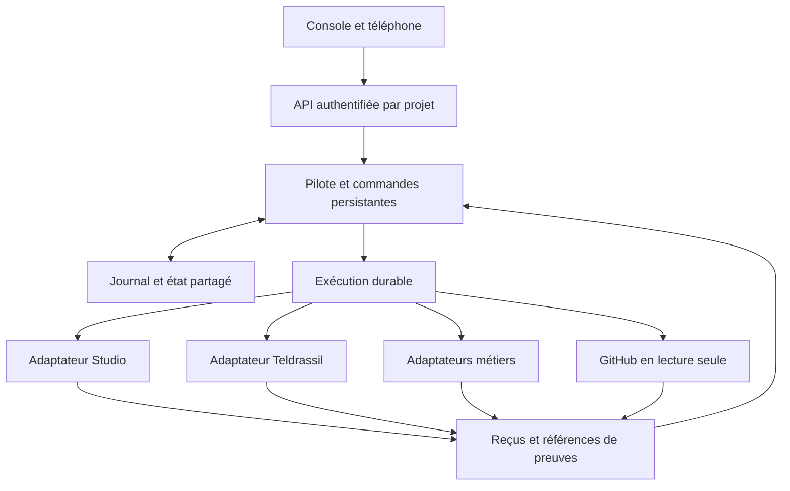

**Revue du 28 octobre 2026 pour Morgan.** Recommandation : garder la console et les moteurs métiers existants, puis leur ajouter un pilote commun qui conserve missions, commandes, coûts et preuves. L’amélioration livrée aujourd’hui est locale : le pilote de contexte existant reçoit une boîte de commandes persistante. Les services proposés ne sont pas installés.

# Ce qui change

La console reste l’interface ; le pilote conserve l’état d’exécution ; chaque projet garde ses données et ses règles. La page de pilotage fait foi pour les mandats et les priorités. Un reçu d’outil fait foi pour son exécution, sans remplacer l’avis artistique de Morgan ni les résultats d’audience.

Schéma cible. Seuls le journal local, la boîte de commandes et leur démonstration sont exécutés ici. L’API, la base partagée, les adaptateurs et le moteur durable restent à éprouver ensemble.

# Constats actuels et frontières

| Élément examiné | Constat au 28 octobre | Décision |
| --- | --- | --- |
| Console et audit du 25 octobre | Projection datée ; suivi local au navigateur ; pas de moteur résident attesté | Conserver l’interface et préparer une API commune, sans annoncer de synchronisation |
| Pilote de contexte existant | Journal SQLite, versions, dédoublonnage, vingt tests historiques relancés | L’enrichir ; préserver les exemples datés et leurs passations reconstituées |
| Momolscode/unum-continuite | README et schéma de tâches relus ; contrat strict de quatre champs | Produire une projection compatible, sans ajouter des champs au schéma ni prétendre à un échange |
| Teldrassil | Branche eaglemic/teldrassil confirmée ; miroir désactivé ; core.url reste null dans la configuration | Garder source, règles de conflit et accusés de réception ; configuration seule ne prouve pas un service absent ou joignable |
| Dépôts de référence | Le code commun Teldrassil les déclare en lecture seule | Ne pas y installer le pilote ni les modifier |
| Jarvis atelier et projets clients | Périmètres et accès distincts | Adaptateurs séparés, activés selon leur mandat ; aucune commande machine ou donnée client dans cette démonstration |

# Dépôts utiles et choix

Versions publiées et licences vérifiées le 28 octobre. Les versions ci-dessous sont des repères de comparaison ; aucun ensemble de dépendances compatible n’est encore testé.

| Brique | Référence | Rôle proposé et condition |
| --- | --- | --- |
| DBOS | [dbos-inc/dbos-transact-py](https://github.com/dbos-inc/dbos-transact-py), 3.3.0 du 15 octobre, MIT | Candidat prioritaire pour files et reprise durable en Python ; comparer au prototype sur le même scénario avant adoption |
| FastAPI | [fastapi/fastapi](https://github.com/fastapi/fastapi), 0.162.0 du 23 octobre, MIT | Entrée typée pour console et adaptateurs ; première étape après choix de l’hébergement et authentification |
| MCP Python SDK | [modelcontextprotocol/python-sdk](https://github.com/modelcontextprotocol/python-sdk), v2.3.0 du 2 octobre, MIT | Exposer des outils précis par projet ; ne donne pas automatiquement accès aux conversations ou aux comptes |
| LangGraph | [langchain-ai/langgraph](https://github.com/langchain-ai/langgraph), 1.2.18 du 26 octobre, MIT | Option pour une boucle de raisonnement avec reprises ; pas nécessaire pour une simple file de commandes |
| Temporal | [temporalio/sdk-python](https://github.com/temporalio/sdk-python), 1.34.0 du 30 septembre, MIT | Alternative à DBOS si le besoin justifie un serveur et des workers dédiés ; ne pas installer les deux par défaut |

Je privilégie DBOS plutôt que Temporal pour le premier essai d’intégration : il s’ajoute à une application Python et s’appuie sur une base, sans serveur d’orchestration distinct. C’est un choix de simplicité proposé, pas un benchmark. Les [documents DBOS](https://docs.dbos.dev/architecture) précisent aussi les contraintes de coordination en distribution. Leur [guide](https://docs.dbos.dev/python/tutorials/database-connection) accepte SQLite pour prototyper et recommande Postgres pour un déploiement distribué.

Pour la cible partagée : Postgres pour les tâches et checkpoints, fichiers médias dans leur stockage existant, références et empreintes dans la base. La mémoire de recherche peut être indexée ensuite ; elle ne remplace pas les faits structurés. [OpenTelemetry](https://opentelemetry.io/docs/what-is-opentelemetry/) fournit une piste pour relier traces, métriques et journaux quand plusieurs services seront réellement présents.

# Contrat commun

Chaque tâche porte projet, responsable, objectif, dépendances, référence de mandat, action permise, budget avec unité et fenêtre, version attendue, statut technique et preuves. Décision de Morgan et audience restent des champs distincts. Un modèle peut proposer une commande ; le processus de confiance vérifie le mandat et les limites déjà accordés. Une autorisation existante ne déclenche pas une nouvelle demande de confirmation à chaque reprise.

Les commandes suivent prepared, submitting, unknown, running puis verified ou failed. Avant l’appel externe, l’intention est enregistrée. Après une coupure, submitting ou unknown impose de retrouver le résultat fournisseur, jamais de soumettre automatiquement une seconde génération. Une clé stable protège les commandes locales ; une étape externe interrompue peut malgré tout avoir été exécutée. Les [garanties DBOS](https://docs.dbos.dev/python/tutorials/workflow-tutorial) imposent aussi de concevoir les étapes rejouables.

Le budget est réservé transactionnellement en unités entières. Un coût final inconnu garde sa réservation. Un dépassement réel est consigné et bloque une nouvelle dépense ; ce mécanisme ne peut pas empêcher un fournisseur de facturer davantage que son devis. Publication, contact et machines restent soumis au mandat de leur projet.

# Ce qui est réellement livré

Le paquet du pilote conserve les modules et preuves 0.1 et ajoute commandes.py, dix-huit tests et une démonstration. **Trente-huit tests passent.** Ils couvrent notamment double réception, concurrence entre deux workers, changement de contenu sous une même clé, plafond réservé, séparation des projets, état inconnu après reprise, reçu d’un autre job et résultat sans preuve.

La démonstration ferme puis rouvre le registre après une remise de commande fictive, bloque sa relance, rapproche un reçu simulé, puis projette le résultat dans le journal de contexte et dans les quatre champs UNUM. Aucun appel externe ou payant ; aucun envoi UNUM. Les horodatages et preuves exactes sont dans le paquet.

Ce module local attend un processus de confiance : il ne possède ni authentification réseau, ni fournisseur réel, ni bascule entre serveurs. Le mot verified indique un reçu technique déclaré par l’adaptateur, pas une vérification automatique de la vérité ou une validation artistique.

# Prochaines preuves

1. Raccorder un seul adaptateur GitHub en lecture seule à l’API : un événement identifié produit un état, son doublon reste sans effet, une révision périmée est refusée.
2. Éprouver le même cas avec DBOS et Postgres, puis interrompre le worker entre appel et accusé. Comparer reprise, temps, maintenance et coût réel au pilote local.
3. Brancher la console sur cette API : deux appareils doivent lire le même état, puis une restauration de sauvegarde doit être vérifiée avant une action payante.

Hébergement, disponibilité des workers, coûts et gestion des secrets restent à cadrer ; aucun abonnement n’est engagé. Les routines existantes et la vidéo différée de Studio restent inchangées. Cette architecture constitue une spécification et un prototype testés localement, pas une installation permanente ni un classement « état de l’art ».

