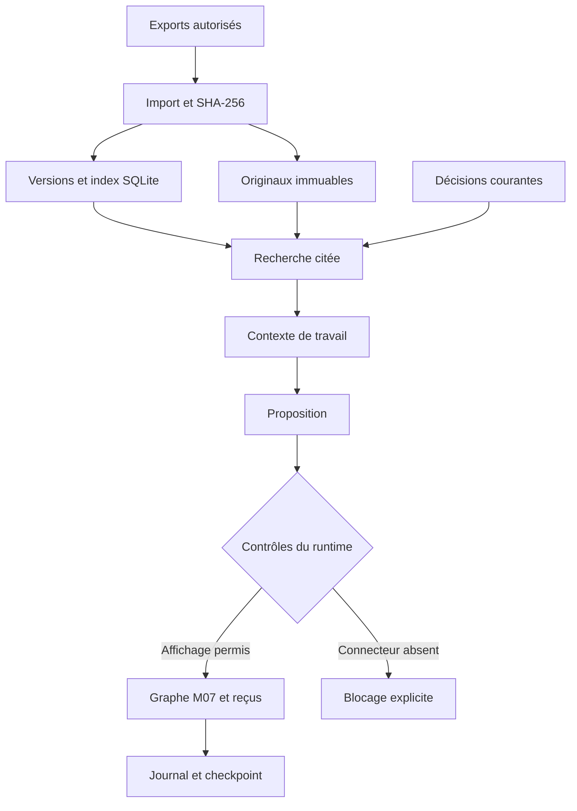

# Architecture

Les checkpoints reprennent une opération ; la mémoire documentaire retrouve des connaissances entre sessions. Les originaux restent indépendants. Git référence les sources par empreinte ; données actives et médias restent privés.

Import/index/recherche et panneau mémoire sont implémentés. La liaison contexte vers proposition décrit le contrat d’extension : le runtime ne transforme pas aujourd’hui un passage documentaire en action autonome.

Un futur connecteur reçoit projet, opération, révision, source, identifiant idempotent, paramètres bornés et autorisation applicable. Il renvoie identifiant fournisseur, état `SUCCEEDED/FAILED/UNKNOWN`, artefacts et empreintes, durée et coût quand connus. Une réponse perdue exige une réconciliation avant répétition.

Voix : micro → ASR → texte/contexte → règles ou Jev → contrôles → affichage/proposition → reçu → TTS. Une seule session micro, refus des réponses périmées. N’envoyer au service distant que les données nécessaires et autorisées.

SQLite FTS5 fournit une recherche lexicale locale. Ajouter embeddings ou PostgreSQL/pgvector après un jeu de questions et des mesures de rappel, citations, latence et besoin multiutilisateur. Aucun moteur vectoriel n’est activé ici.

Git : code et petites métadonnées. Stockage privé : médias et sauvegardes. DVC : option de versionnement de gros jeux de données, sans remote configuré. Git LFS est une alternative ; ne pas cumuler les deux sur les mêmes fichiers. Sources : `RESEARCH_2026-11-01.md`.
