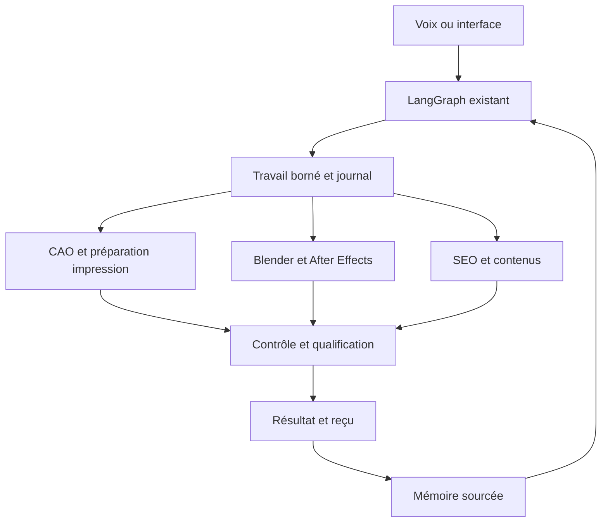

# BOJ.ART — outils, skills et conditions de lancement

Recherche du **1 novembre 2026**. Dépôt examiné à `5268e7e7b70fa25efee7d186f27cd3716a49c4c1`, puis rapproché de `461d46ff39caaf142ce37a3e0b78f22dfcc2e842` et de `9f58fa29f0051cc8a7098855359a8a6dd0eef7e6`. **Cette livraison enrichit la préparation et la mémoire ; elle n'installe pas les outils sur la tour.**

## Décision

Conserver LangGraph, la mémoire existante et les six skills BOJ.ART. Ajouter des capacités par essais bornés, avec une preuve d'entrée, de sortie et de reprise. La priorité est le raccordement aux machines, aux vrais assets artistiques et aux résultats commerciaux. Le nombre de dépôts, de fichiers ou de skills ne mesure pas la qualité du système.

Le code `jarvis/apps/jarvis/app/launch_readiness.py` indique explicitement `production_ready: false`, `physical_printer_commands: false` et un mode de démonstration. Le fichier `context/CURRENT.md` recense une collecte de 3 340 contenus uniques ; cette étude n'a pas revérifié les octets de cette collecte ni sa couverture. Il existe donc un patrimoine documentaire conséquent, avec encore des données opérationnelles manquantes.

## 1. Chaîne retenue et première preuve

| Domaine | Choix | Ce que l'on doit effectivement démontrer |
|---|---|---|
| Orchestration | **LangGraph existant**, checkpoints et journal `bojart_ops` | Une coupure après soumission ne produit pas un second rendu payant ou un second travail machine. |
| Voix | **faster-whisper existant**, puis **Pipecat** si utile | Voix française dans le bruit, interruption, négation, confirmation liée au bon dossier et reprise. Jev reste un décideur facultatif après transcription. |
| Mémoire | **Mémoire SQLite/FTS5 existante + Docling** comme extracteur candidat | Un tableau de manuel est retrouvé avec sa page et son original ; une ancienne instruction n'écrase pas une correction validée. |
| Pièces techniques | **CadQuery + Trimesh**, déjà déclarés ; **Manifold** à essayer | Unités, dimensions, volume machine, assemblage et coupon réellement mesuré. Une forme étanche n'est pas automatiquement résistante ou imprimable. |
| Sculpture et VFX | **Blender Python/CLI** | Modèle fidèle, rig, mouvement, caméra, matières et ombres de contact dans un plan contrôlé. |
| FDM | **OrcaSlicer CLI + Moonraker**, sous condition de compatibilité | Profil exact, G-code relu, état de la bonne machine, essai supervisé, suivi et absence de doublon. |
| Résine | Slicer de la machine + **UVtools** | Format accepté, îlots, poches, ventouses et supports vérifiés, puis petite pièce et post-traitement qualifiés. UVtools n'est pas un pilote universel. |
| After Effects | **ExtendScript + aerender** ; **AE MCP Bridge** comme candidat d'interaction | Modification sur copie, rendu avant/après, annulation, export et réouverture de la composition. |
| Habillage et montage | **Skills Remotion officiels**, FFmpeg existant ; **OpenTimelineIO** en second temps | Texte exact, sous-titres, déclinaisons et coupes vérifiés. Une timeline échangée ne transporte pas automatiquement tous les effets. |
| Génération | **Higgsfield** avec reçus existants ; **ComfyUI** comme worker local candidat | Références verrouillées, modèle exact, coût, identifiant, récupération et hash du média. La disponibilité dans ChatGPT ne vaut pas intégration au Jarvis local. |
| SEO et marketing | **Six skills BOJ.ART**, sélection `marketingskills`, **Search Console** et outils natifs TikTok | Une offre réelle, une page, un contenu et une demande de devis traçables. Statistiques absentes = inconnues, pas zéros. |

Les liens et références Git exactes des **18 dépôts** se trouvent dans [SOURCE_SNAPSHOT.json](SOURCE_SNAPSHOT.json). Les **26 fiches de capacités et alternatives** de [TOOLCHAIN.json](TOOLCHAIN.json) indiquent priorité, limite, entrée manquante et premier test. Ce catalogue est une proposition, pas un installateur. Les commits épinglent la recherche, pas des versions déclarées stables pour le poste.

## 2. Skills réellement utiles

**Déjà présents dans le dépôt** : `bojart-social-search`, `bojart-seo-site`, `bojart-creative-packaging`, `bojart-publishing`, `bojart-growth-measurement`, `bojart-knowledge-review`. Leur présence a été vérifiée ; leur invocation par l'agent installé sur la tour reste à prouver.

| Source | Sélection proposée | Application BOJ.ART |
|---|---|---|
| [AE MCP Bridge](https://github.com/solomondivyananth/aftereffects-mcp) | `ae-camera-3d`, `ae-motion-principles`, `ae-audio-sync`, `ae-vfx-cleanup`, `ae-motion-proof`, `ae-deliver` | Caméra, rythme, contacts, son, revue des plans et export. Commencer par l'inspection et les opérations bornées. |
| [Remotion](https://github.com/remotion-dev/skills) | `remotion-best-practices`, `remotion-markup`, `remotion-captions`, `remotion-render` | Habillage, sous-titrage et variantes reproductibles à partir d'un master. |
| [Marketing Skills](https://github.com/coreyhaines31/marketingskills) | `product-marketing`, `seo-audit`, `ad-creative`, `ads`, `analytics`, `conversion-tracking` | Formaliser offre, intention, création publicitaire et mesure ; compléter les skills BOJ.ART sans les dupliquer. |

Périmètre de lecture : README, sécurité et deux corps de skills AE (`ae-vfx-cleanup`, `ae-character-rig`) examinés ; routeur Remotion lu ; corps principaux `product-marketing`, `seo-audit`, `ads` récupérés et examinés sélectivement. Références annexes et code complet non audités. Les autres noms sont confirmés dans les arbres Git, sans audit intégral de leur contenu. Aucun skill tiers copié ou installé.

Deux limites déterminantes : le skill `ae-character-rig` concerne un personnage **2D découpé**, pas le rig 3D fidèle d'une sculpture. Le pont AE documente aussi des étapes manuelles pour Mocha, Roto Brush et certaines fonctions Puppet. Il propose une liaison facultative avec Jev pour traduire des remarques en propositions de retouche ; ce n'est pas la preuve que notre Jev local est raccordé à AE. Son modèle par défaut doit être fixé et son contrat testé avant adoption.

## 3. Ce que l'on écarte ou diffère

- **Hunyuan3D-2.1** : [licence actuelle](https://github.com/Tencent-Hunyuan/Hunyuan3D-2.1/blob/main/LICENSE) excluant l'Union européenne de son territoire. Non retenu pour le déploiement en France dans ces conditions.
- **TRELLIS.2** : candidat de recherche, pas dépendance de lancement. Le [README examiné](https://github.com/microsoft/TRELLIS.2) annonce Linux testé et au moins 24 Go de VRAM NVIDIA. Les temps H100 publiés ne sont pas des performances du PC BOJ.ART. Une sortie image-vers-3D reste à réparer, mettre à l'échelle et préparer pour la fabrication.
- **OR-Tools** : utile après collecte des durées réelles, capacités et temps opérateur. D'abord une file simple fiable ; ensuite mesurer le gain de planification.
- **Nexrender** : à introduire après validation d'un template `.aep`. Il automatise sa déclinaison, pas la conception artistique du film.
- **Metricool** : non retenu pour cette demande après refus de l'installation. Aucun branchement réalisé. La voie active proposée utilise les données natives/exportées. Son MCP documente les statistiques publicitaires, mais pas la gestion des campagnes.
- **Nouveau moteur d'agents ou seconde base vectorielle** : pas de justification actuelle. Étendre le moteur et la mémoire déjà présents avant d'ajouter une infrastructure.

## 4. Architecture proposée

Chaque travail référence ses entrées et leurs empreintes, la version du moteur, les paramètres, l'autorisation applicable, le coût plafond éventuel et le reçu. Une réponse réseau perdue conduit à un état inconnu à réconcilier, pas à une resoumission aveugle. Pour la machine, préparer/trancher et lancer physiquement sont deux capacités distinctes.

La tour réelle n'est pas accessible pendant cette étude. Ne pas imposer un OS avant inventaire : After Effects réclame un poste compatible Windows/macOS ; TRELLIS.2 est documenté sous Linux. Si ces deux voies sont retenues, isoler les workers et leurs environnements, avec des fichiers et reçus communs. Ne pas fusionner toutes les dépendances CUDA, Blender et Python dans un environnement unique non testé.

## 5. Les données dont Jarvis a besoin

Le [registre de données](DATA_REQUIREMENTS.json) décrit **14 jeux de données**, leurs champs et leur état de couverture. Il ne contient aucun secret ou donnée client. Les valeurs réelles restent dans l'état privé, à relier par identifiants aux sources.

Priorités :

1. **Tour et parc** : OS, GPU/VRAM, pilotes, micro, moniteurs, versions AE/Blender ; une fiche par imprimante avec modèle, firmware, volume, format et accès autorisé.
2. **Production** : profils machine/matière réellement essayés, tolérances, temps de finition, échecs, reprises, coûts et maintenance. Une dizaine de fiches fiables vaut mieux qu'une bibliothèque de profils non qualifiés.
3. **Identité artistique** : logo vectoriel maître, palette et polices validées, photographies multi-angles des œuvres, dimensions, rig, textures, droits, bons exemples et refus documentés. G2 fidèle reste un besoin recensé dans la continuité.
4. **Commerce et audience** : offres réalisables, marges, délais, capacité, comptes exacts, statistiques par vidéo, demandes de devis et résultats. Conserver date, fenêtre, définition et dénominateur de chaque mesure.

Docling peut aider à extraire des données de manuels et PDF. Il ne crée pas les informations absentes. Les faits extraits doivent garder source, page, date, unité et statut de validation. Les archives originales ne sont pas remplacées par les extractions.

## 6. Identité, signature et TikTok

**Proposition de réalisation à tester, non charte déjà approuvée : « la main déclenche l'impossible ».** Un geste réel de l'artiste déclenche une transformation lisible ; la scène revient sur l'œuvre réelle et son auteur. Le geste, la matière et l'emblème existant deviennent les repères de série. Préserver les couleurs de peinture ; ne pas inventer une nouvelle palette faute de charte.

Signature sonore à construire à partir de sons enregistrés dans l'atelier : contact de l'outil, texture de matière, accent de transformation et retour au lieu. Une musique seule ne valide pas le sound design. Pour la sculpture animée, exiger poids, contacts, ombres, déformations et continuité ; ne pas remplacer le mouvement par un zoom photographique.

Les rôles `@boj.art` = révélation/portfolio et `@boj.art3d` = gestes/fabrication viennent du contexte existant et restent des **hypothèses éditoriales**. Les identifiants de connexion et la couverture statistique ne sont pas confirmés.

| Contenu réellement montré | Intention de recherche candidate | Hashtags de départ à tester |
|---|---|---|
| Fabrication 3D | « comment fabriquer une figurine en impression 3D » | `#BOJART #Impression3D #Figurine #Fabrication` |
| Peinture et finition | « peinture de figurine étape par étape » | `#BOJART #PeintureFigurine #Figurine #AtelierArtiste` |
| Révélation d'une sculpture | « sculpture personnalisée » si l'offre existe | `#BOJART #Sculpture #CreationArtistique #Art` |
| Démonstration de compositing | « animation 3D d'une sculpture » | `#BOJART #VFX #Animation3D` ; ajouter `#Blender3D` ou `#AfterEffects` seulement si réellement utilisés |

Ces tags ne sont ni un classement de tendances ni une limite officielle de quantité. TikTok décrit les hashtags comme un signal parmi d'autres ; la correspondance à la recherche et les interactions comptent également. [Creator Search Insights](https://newsroom.tiktok.com/creator-search-insights?lang=en) permet d'examiner sujets et lacunes là où l'outil est disponible. Conserver pays et période pour toute observation du [Creative Center](https://ads.tiktok.com/business/creativecenter/inspiration/popular/hashtag/pc/en).

Sans plugin : recueillir dans TikTok Studio les métriques effectivement disponibles, avec leur source et fenêtre ; exporter si le compte propose l'option. Aucun format d'export TikTok n'a été testé ici. Normaliser ensuite dans l'état privé selon `social_metrics`. La durée moyenne divisée par la durée du film n'est pas un taux de complétion. Ne pas additionner les audiences des deux comptes comme des personnes uniques.

## 7. SEO, campagnes et apprentissage

Choisir une offre commercialisable puis relier **contenu → page pertinente → demande → devis qualifié → vente**. Les requêtes « figurine personnalisée », « sculpture sur mesure » et « prototype impression 3D » sont des pistes, pas des volumes de recherche mesurés. Les pages locales attendent confirmation de la zone et de l'adresse de l'activité.

Utiliser Search Console pour les requêtes, pages et indexation ; conserver les filtres, les dates et les limites d'export. Google documente l'[export CSV](https://support.google.com/webmasters/answer/12919797?hl=fr) et ses limites : échantillon limité dans l'interface, certains absents transformés en zéros. Aucun export BOJ.ART n'a été fourni ou analysé dans cette étude. Vérifier aussi rendu mobile, formulaire, sitemap et balisage correspondant au contenu visible.

Google indique que les fichiers spéciaux de type `llms.txt` ne sont pas nécessaires à sa visibilité générative. Priorité aux œuvres originales, pages utiles et preuves de savoir-faire, conformément à son [guide officiel](https://developers.google.com/search/docs/fundamentals/ai-optimization-guide).

Pour une première campagne : objectif proposé = demande de devis qualifiée ; offre et audience explicites ; un angle créatif à comparer ; destination et événement testés ; budget plafond et critère d'arrêt définis avant activation. Aucun montant, CPA cible ou ROAS inventé. Mesurer le coût par demande qualifiée et la conversion en devis/vente, pas seulement les vues.

Le [MCP officiel TikTok for Business](https://business-api.tiktok.com/portal/docs/how-to-connect-chatgpt-to-tiktok-for-business-mcp-server/v1.3) est une piste Ads documentée, avec une découverte progressive des outils et OAuth. Il n'est pas connecté ici. Il ne remplace pas la publication organique. Ne pas construire un utilitaire interne Direct Post en supposant son agrément : les [règles TikTok](https://developers.tiktok.com/docs/en/content-sharing-guidelines) excluent cet usage limité aux comptes de sa propre équipe. Le brouillon exportable reste le repli.

## 8. Passage au lancement

Les critères de recette sont dans [ACCEPTANCE.json](ACCEPTANCE.json), raccordés aux portes existantes. Leur statut initial est **non exécuté sur la tour**. Ordre proposé :

1. Installer le socle existant, exécuter son diagnostic, rechercher les références nouvelles et restaurer une sauvegarde dans un autre dossier.
2. Qualifier voix et trois écrans avec une commande de consultation et une création de socle.
3. Qualifier une FDM, puis une résine ; étendre ensuite au parc, avec profils et retours mesurés.
4. Qualifier un plan Blender/AE sur la vraie œuvre, puis son export, son son et sa fidélité. Garder le master et les refus.
5. Relier une offre, un contenu et une demande de devis ; intégrer les statistiques réelles avant d'optimiser hashtags et campagnes.

Le lancement complet nécessite ces preuves. En attendant, annoncer séparément les fonctions disponibles, celles en démonstration et celles bloquées. Cette recherche ne démontre ni une supériorité « state of the art » ni la viralité ; elle définit une chaîne vérifiable pour progresser vers le niveau demandé.

## Amélioration logicielle livrée avec la recherche

L'ajout du dossier à la sélection de référence a fait échouer un cas de recherche existant : l'état courant sortait des cinq premières sources pour une requête sur le moteur d'orchestration. La mémoire distingue désormais `canonical` et `research` dans la même base. Les deux points d'indexation utilisent la même procédure ; les sources de référence conservent leur priorité lexicale et après fusion sémantique. Les extraits de recherche portent explicitement le libellé « PROPOSITION DE RECHERCHE » et leur collection dans les métadonnées.

Une recherche retirée ou reclassée est désélectionnée sans supprimer ses anciennes versions. Sept tests couvrent classement, retrait, reclassement, doublons, CLI et restauration ; le contrôle documentaire contient désormais quatorze questions, avec les attentes historiques conservées. Ces tests n'évaluent pas les réponses d'un LLM réel. Le classement de référence ne transforme pas une source en vérité : les statuts et preuves du registre restent nécessaires.

## Sources et limites de vérification

- Métadonnées et commits : [SOURCE_SNAPSHOT.json](SOURCE_SNAPSHOT.json), sans classement par étoiles ni audit de sécurité exhaustif.
- Adobe : [scripts](https://helpx.adobe.com/after-effects/using/scripts.html), [rendu automatisé](https://helpx.adobe.com/fr/after-effects/desktop/render-and-export/automate-rendering/automated-rendering-network-rendering.html).
- Blender : [rendu CLI](https://docs.blender.org/manual/en/latest/advanced/command_line/render.html), [Python en arrière-plan](https://docs.blender.org/api/main/info_tips_and_tricks.html).
- Impression : [OrcaSlicer CLI](https://github.com/OrcaSlicer/OrcaSlicer/wiki/cli_mode), [file Moonraker](https://moonraker.readthedocs.io/en/latest/external_api/job_queue/), [UVtools](https://github.com/sn4k3/UVtools).
- Remotion : [licence et termes](https://www.remotion.dev/docs/license). La licence du moteur et les conditions des poids, assets et dépendances restent distinctes de celles des dépôts.
- TikTok : [recommandations et recherche](https://support.tiktok.com/en/using-tiktok/exploring-videos/how-tiktok-recommends-content) ; aucune statistique de compte consultée.
- Metricool : [FAQ officielle](https://help.metricool.com/faqs-about-the-metricool-mcp-1i3w0). Le dépôt `metricool/mcp-metricool` cité par cette page a retourné 404 lors de la vérification : ne pas installer un homonyme communautaire comme substitut supposé officiel.

Les validations réellement exécutées pour cette livraison sont consignées dans `VALIDATION.json`. Elles concernent la cohérence documentaire et la recherche locale, pas les logiciels tiers ou le matériel de production.
